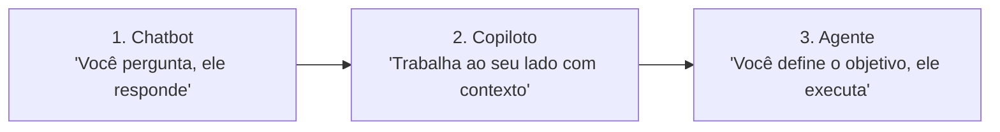

# 🧠 Módulo 1: Conceitos e Fundamentos de Agentes de IA

Para construir e entender este projeto, o primeiro passo é desmistificar o que é um **Agente de IA** e como ele se diferencia de outros produtos de inteligência artificial que usamos no dia a dia.

---

## 1. A Escala de Autonomia: Chatbot ➔ Copiloto ➔ Agente

No curso da DIO, aprendemos que a interação com a IA acontece em três níveis crescentes de autonomia:

### Nível 1: Chatbot (O Consultor)
* **Como funciona:** Você digita uma mensagem na caixa de texto do ChatGPT ou Gemini, e ele responde com base no conhecimento prévio do modelo.
* **Limitação:** Ele é reativo e isolado. Ele não acessa seus arquivos locais, não abre programas no seu computador e não toma iniciativas por conta própria.

### Nível 2: Copiloto (O Colega de Trabalho)
* **Como funciona:** O copiloto fica inserido na sua ferramenta de trabalho (como o GitHub Copilot no VSCode ou o Gemini no Google Docs). Ele "enxerga" o que você está escrevendo e sugere melhorias em tempo real.
* **Limitação:** Ele ainda depende de você estar ativamente digitando e aprovando cada sugestão linha por linha.

### Nível 3: Agente (O Assistente de Confiança com Autonomia)
* **Como funciona:** Você não pede para o modelo apenas "escrever um texto". Você delega uma **meta orientada a objetivo**:
  > *"Todo dia, monitore 10 portais de notícias de tecnologia, leia 40 matérias, filtre as mais relevantes do Brasil e do mundo, sintetize os pontos de impacto e monte uma página web completa abrindo-a no meu navegador."*
* O agente:
  1. **Percebe o ambiente** (conecta à internet via RSS);
  2. **Raciocina e julga** (identifica quais notícias têm real relevância profissional e descarta propagandas);
  3. **Executa ações concretas no computador** (cria pastas, gera arquivos Markdown e HTML, programa o agendador de tarefas);
  4. **Entrega o resultado pronto** para o usuário.

---

## 2. A Anatomia do Nosso Agente Resumidor

Todo agente autônomo é composto por quatro engrenagens principais:

| Componente | O que faz no conceito | Como implementamos no projeto |
| :--- | :--- | :--- |
| **Sensores / Percepção** | Coleta dados brutos do mundo exterior | Módulo [`rss_fetcher.py`](../agente-resumidor-noticias/rss_fetcher.py), que lê feeds RSS de 10 veículos de tecnologia e extrai títulos, resumos e links. |
| **Cérebro / Raciocínio** | Analisa, julga prioridades e traduz dados | Módulo [`ai_curator.py`](../agente-resumidor-noticias/ai_curator.py), que envia as matérias para o Google Gemini classificar o impacto e gerar análises críticas. |
| **Atuadores / Execução** | Modifica o ambiente e gera resultados | Módulos [`main.py`](../agente-resumidor-noticias/main.py) e [`html_generator.py`](../agente-resumidor-noticias/html_generator.py), que gravam os arquivos `.md` e `.html` no disco e disparam o navegador. |
| **Gatilho / Agendamento** | Decide *quando* o agente deve agir | Scripts [`agendar_rotina.bat`](../agente-resumidor-noticias/agendar_rotina.bat) e Agendador de Tarefas do Windows, disparando o fluxo todos os dias às 13:00. |

---

## 3. Por que Começar com Curadoria de Notícias?

Muitos iniciantes começam tentando criar robôs excessivamente complexos e desistem diante de erros difíceis de depurar. 

Uma automação de curadoria inteligente de notícias é o **projeto ideal para começar** porque:
1. Trabalha com **dados reais e dinâmicos** (a cada execução as notícias mudam);
2. Lida com **múltiplos formatos** (XML/RSS na entrada ➔ JSON estruturado no processamento ➔ Markdown e HTML na saída);
3. Resolve uma **dor real do dia a dia** (economiza 30 minutos de leitura diária com uma curadoria de alta qualidade);
4. Tem custo praticamente **zero** utilizando o modelo gratuito do Google AI Studio.
