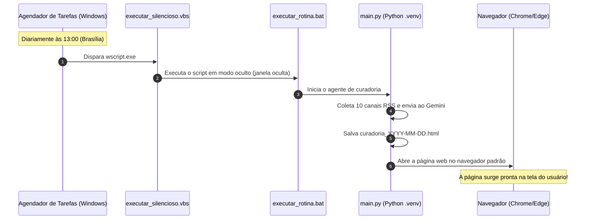

# ⏰ Módulo 4: Automação e Agendamento Diário (13:00 Brasília)

Um dos maiores diferenciais de um **Agente Autônomo** em relação a um Chatbot comum é que o agente não espera você sentar na frente do computador e pedir: ele **executa no horário programado por conta própria**.

Neste capítulo, explicamos como a rotina das **13:00 (Horário de Brasília)** foi configurada para funcionar silenciosamente no Windows.

---

## 1. Como Funciona a Rotina Automática?

O fluxo diário segue o diagrama abaixo:



---

## 2. O Desafio da Janela Preta do Terminal e a Solução com VBScript

### O Problema:
Se você agendar um arquivo `.bat` comum no Windows, no exato momento das 13:00 uma janela preta do prompt de comando (`cmd.exe`) piscará no meio da sua tela, interrompendo o que você estiver fazendo.

### A Solução Elegante com VBScript:
Criamos o arquivo [`executar_silencioso.vbs`](../agente-resumidor-noticias/executar_silencioso.vbs):
```vbscript
Set fso = CreateObject("Scripting.FileSystemObject")
scriptDir = fso.GetParentFolderName(WScript.ScriptFullName)
Set WshShell = CreateObject("WScript.Shell")
WshShell.CurrentDirectory = scriptDir
WshShell.Run """" & scriptDir & "\executar_rotina.bat""", 0, False
```
* O parâmetro `0` instrui o Windows a rodar o processo **100% invisível** em segundo plano.
* O processo só se torna visível quando o Python termina a curadoria e abre a página HTML no seu navegador!

---

## 3. Os Scripts Criados para o Usuário

Você não precisa abrir o painel complexo do Windows para configurar nada. Criamos scripts com 1 clique:

| Arquivo | O que faz ao dar duplo clique |
| :--- | :--- |
| [`agendar_rotina.bat`](../agente-resumidor-noticias/agendar_rotina.bat) | Registra a tarefa diária no Windows para rodar todo dia às 13:00. |
| [`testar_rotina_agora.bat`](../agente-resumidor-noticias/testar_rotina_agora.bat) | Dispara o agendador em segundo plano imediatamente para você testar sem esperar até as 13h. |
| [`remover_rotina.bat`](../agente-resumidor-noticias/remover_rotina.bat) | Remove a tarefa do sistema caso queira desativar a automação. |
| [`executar.bat`](../agente-resumidor-noticias/executar.bat) | Executa o agente manualmente mostrando os logs coloridos no terminal. |

---

## 4. Como Conferir a Tarefa no Windows

Se você quiser ver a tarefa registrada visualmente no Windows:
1. Pressione `Windows + R` no teclado;
2. Digite `taskschd.msc` e aperte `Enter` (abrirá o **Agendador de Tarefas**);
3. Na lista central, você verá a tarefa chamada **`AgenteNoticiasDIO`**;
4. No status, você verá:
   * **Status:** `Pronto` (ou *Ready*);
   * **Disparadores:** `Diariamente às 13:00:00`;
   * **Próxima hora de execução:** próxima ocorrência das 13:00.
