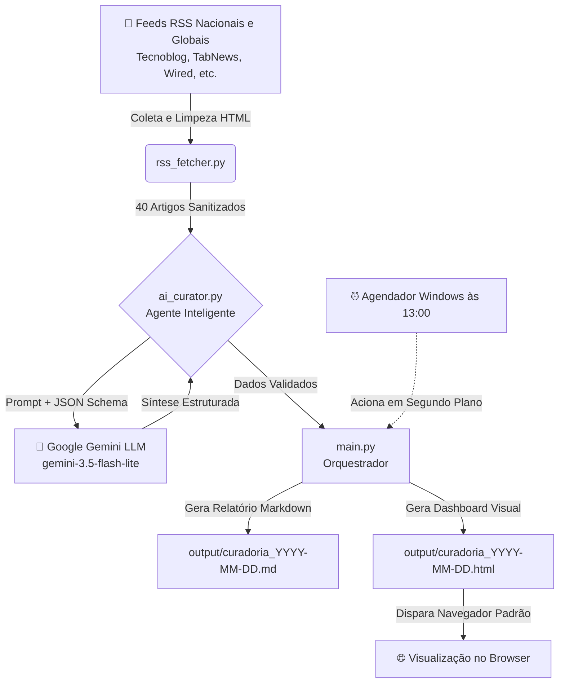

# 📖 Guia Didático: Construindo um Agente de IA do Zero

Bem-vindo ao **Guia Didático do Projeto**! Esta pasta foi criada especialmente para explicar, de forma **clara, didática e passo a passo**, como este projeto foi concebido, quais decisões de arquitetura foram tomadas e quais tecnologias foram empregadas para transformar uma ideia em um **Agente Autônomo Funcional**.

---

## 🎯 Para Quem é Este Guia?

Este material foi pensado tanto para **iniciantes** que estão dando os primeiros passos em programação e Inteligência Artificial, quanto para desenvolvedores que desejam entender como conectar modelos de linguagem (LLMs) a fluxos de trabalho reais do sistema operacional.

---

## 📚 Sumário dos Módulos Didáticos

Navegue pelos capítulos abaixo para compreender cada detalhe do projeto:

1. [**01. Conceitos Fundamentais de Agentes de IA**](01-conceitos-e-fundamentos.md)
   * A evolução: Chatbot ➔ Copiloto ➔ Agente Autônomo.
   * Por que automações de leitura de notícias são o laboratório perfeito para começar.
   * O ciclo de percepção, raciocínio e execução.

2. [**02. Linguagens, Ferramentas e Bibliotecas Utilizadas**](02-linguagens-e-ferramentas.md)
   * Detalhamento de cada peça do projeto: Python 3.13, API do Google Gemini, Feedparser, Requests, Dotenv.
   * O papel do HTML5 moderno com Glassmorphism, CSS puro e JavaScript nativo.
   * A tecnologia de automação do Windows (PowerShell, VBScript e Agendador de Tarefas).

3. [**03. Passo a Passo da Construção (Do Zero à Produção)**](03-passo-a-passo-construcao.md)
   * As 7 etapas cronológicas de desenvolvimento do projeto.
   * Como estruturar código modular e evitar armadilhas de iniciantes (como dependências globais ou falhas de encoding no terminal).

4. [**04. Como Funciona a Rotina Automática Diária (13:00)**](04-automacao-e-agendamento.md)
   * Como agendar tarefas no Windows sem janelas pretas piscando na tela (*background execution*).
   * Como abrir o navegador automaticamente com a nova curadoria do dia.

5. [**05. Como Personalizar e Evoluir o Agente**](05-personalizacao-e-proximos-passos.md)
   * Adicionando novas fontes de notícias ou newsletters.
   * Ideias de evolução: envio para bots do Telegram, Discord ou e-mail corporativo.

---

## 🧭 Mapa Mental da Arquitetura do Projeto

